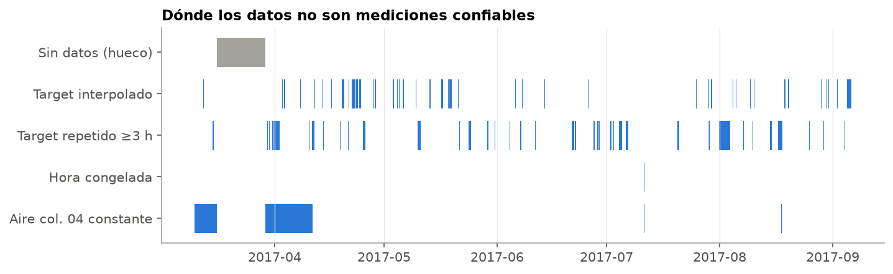
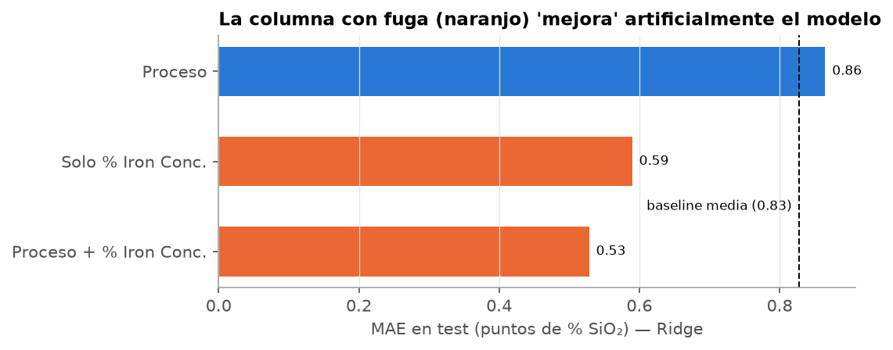
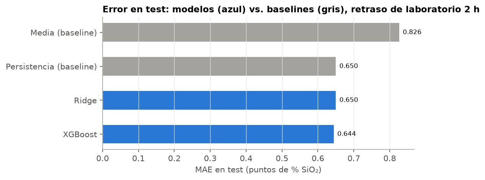
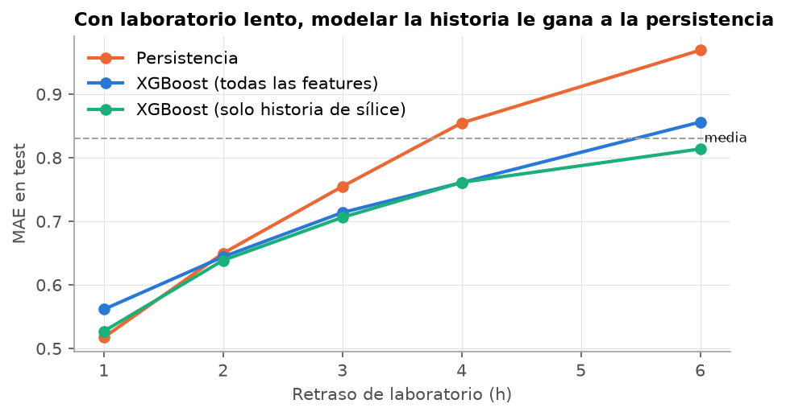
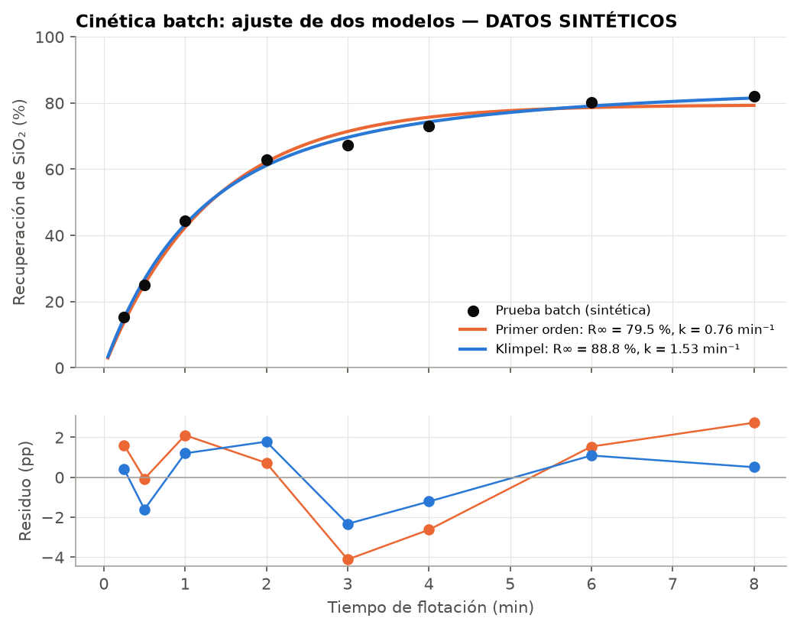

# Predicción de sílice en el concentrado de una planta de flotación de hierro

Estimo la sílice del concentrado de una planta de flotación inversa de hierro y la comparo con lo que la operación ya tiene sin modelo: el último ensayo de laboratorio. Con 2 h de retraso hay empate; la mejora se distingue del ruido desde 4 h de retraso (11 %).

**Datos:** [Quality Prediction in a Mining Process](https://www.kaggle.com/datasets/edumagalhaes/quality-prediction-in-a-mining-process) (Kaggle) — planta real de flotación de mineral de hierro, marzo–septiembre 2017, 737 453 filas.

---

## 1. El problema, en lenguaje de planta

La sílice en el concentrado define su calidad: mientras menos, mejor. El laboratorio la mide por hora y el resultado llega tarde, mientras el proceso se registra cada 20 segundos. La pregunta del proyecto es si, al cierre de cada hora, se puede estimar la sílice de esa hora mejor que mirando el último ensayo disponible. El retraso del laboratorio no está documentado en los datos: supuse 2 h y lo dejé como parámetro.

## 2. La flotación inversa de hierro en 3 líneas

En flotación inversa lo que flota es la ganga, no el producto.
La amina hace hidrofóbico al cuarzo y las burbujas lo llevan a la espuma.
El almidón deprime los óxidos de hierro, que salen por el fondo como concentrado.

## 3. Decisiones de datos

### 3.1 Frecuencias reales y calidad de datos

`date` está truncada a la hora, así que conté cuántos valores distintos toma cada columna por hora. El proceso cambia cada ~20 s y las leyes de alimentación solo a las 01, 07 y 16 h, lo que sugiere un compósito por turno. De 4097 horas, solo 3362 tienen un ensayo real: el resto son interpolaciones, valores repetidos u horas congeladas. Evalúo solo con esas horas.



### 3.2 Fuga de información: `% Iron Concentrate`

`% Iron Concentrate` sale del mismo ensayo que la sílice: cuando se quiere estimar la sílice, el hierro de esa hora tampoco existe. Con esa columna, un Ridge parece 36 % mejor que la media; sin ella queda 4 % peor. No predice casi perfecto (R² 0,53), porque los otros óxidos rompen el balance de masa exacto, pero sigue siendo fuga por su origen. La excluí de todo el modelado.



### 3.3 Validación temporal

Entreno hasta el 31 de julio (2586 h) y evalúo del 4 de agosto al 9 de septiembre (740 h). Dentro del train uso `TimeSeriesSplit`. Ningún hiperparámetro se eligió con el test, pero sí lo miré para comparar grupos de features, retrasos y regímenes: esas comparaciones son descriptivas. Un split aleatorio por fila da un resultado muy distinto, porque cada hora tiene unas 180 filas con la misma sílice y el modelo copia el valor:

| Split (mismo XGBoost, columnas crudas, filas de 20 s) | MAE | R² |
|---|---|---|
| Aleatorio por fila | 0,39 | **0,71** |
| Temporal | 0,85 | **−0,11** |

### 3.4 Retraso de laboratorio y features sin fuga

Las features responden a una pregunta: qué se sabe al cierre de la hora. Uso el proceso hasta esa hora y sus rezagos de 1 a 3 h, la historia de sílice con al menos `lab_delay` horas de antigüedad y el último compósito de alimentación ya reportado. Los tests en `tests/` alteran un dato y comprueban que ninguna feature anterior cambie.

La amina es la variable más correlacionada con la sílice, pero con el signo contrario al esperado, y su correlación máxima aparece 3 h después de la sílice (ρ 0,38). Es compatible con una reacción de control, aunque no pude confirmarlo. Por eso este modelo no sirve para recomendar dosis.

## 4. Resultados

Con 2 h de retraso, los modelos y el último ensayo no se distinguen: el intervalo de la diferencia incluye el cero. XGBoost sí reduce el RMSE 9 %, porque comete menos errores grandes, aunque llega tarde a los picos. Las variables de proceso no agregan señal distinguible sobre la historia de sílice.



Test: 04-ago → 09-sep 2017 (740 h), retraso de laboratorio de 2 h.

| Modelo | MAE | RMSE | R² | vs. media | vs. persistencia | IC 95 % de la diferencia de MAE |
|---|---|---|---|---|---|---|
| Media (baseline) | 0,826 | 1,051 | 0,00 | — | −27 % | — |
| Persistencia (baseline) | 0,650 | 0,931 | 0,21 | +21 % | — | — |
| Ridge | 0,650 | 0,880 | 0,30 | +21 % | 0,0 % | −0,04 a +0,04 |
| XGBoost | 0,644 | 0,846 | 0,35 | +22 % | +0,9 % | −0,03 a +0,04 |

IC por bootstrap de bloques de 48 h, en puntos de % SiO₂. Si incluye el cero, la diferencia no se distingue del ruido.



### Anexo: cinética batch (datos sintéticos)

> **Los datos de esta sección son SINTÉTICOS**, generados con un modelo conocido más ruido. No son
> mediciones de laboratorio ni describen esta planta; sirven para mostrar el procedimiento de ajuste.



## 5. Limitaciones y qué haría con más datos

- **Un solo periodo de test.** Son ~5,5 semanas de una planta; confirmaría los hallazgos con otro periodo.
- **Supuestos sin documentar.** El retraso de 2 h, el compósito por turno y el lazo de control salen de los datos, no de la operación.
- **Regímenes como hipótesis.** La mejora con alimentación de sílice alta (16 %) aparece en un grupo elegido mirando el test.
- **Intervalos débiles en los picos.** El de 90 % cubre 84 % o 64 % con sílice alta, según el método.
- **Planta en lazo cerrado.** Sin variación planificada de dosis no se pueden estimar efectos causales.

Con datos de laboratorio usaría los timestamps reales de muestra y resultado, y ensayos de alimentación más frecuentes. Con mineralogía y granulometría se podría probar si la sílice difícil de predecir se explica por el tipo de mineral.

---

## Estructura del repositorio

```
flotacion-silica-prediction/
├── notebooks/
│   ├── 01_eda.ipynb          # diagnóstico de datos, EDA de proceso, experimento de fuga
│   ├── 02_modelo.ipynb       # validación temporal, baselines, Ridge, XGBoost, análisis de error, SHAP
│   └── 03_cinetica.ipynb     # cinética batch (DATOS SINTÉTICOS)
├── src/
│   ├── config.py             # rutas, semilla, target, columnas con fuga, inicio del test
│   ├── data.py               # carga y diagnóstico de calidad
│   ├── eda.py                # perfiles por decil y correlación con desfase
│   ├── features.py           # features horarias con retraso de laboratorio configurable
│   ├── models.py             # Ridge (Pipeline) y XGBoost con early stopping temporal
│   ├── evaluation.py         # métricas, CV temporal, error por régimen, intervalos
│   ├── kinetics.py           # modelos cinéticos y ajuste con IC
│   ├── viz.py                # estilo de gráficos
│   └── download_data.py      # descarga del dataset
├── tests/                    # tests de no-fuga y del bootstrap
├── reports/figures/          # figuras generadas por los notebooks
└── data/                     # no versionado
```

## Cómo reproducir

Requiere Python 3.11.

```bash
py -3.11 -m venv .venv
.venv\Scripts\activate
pip install -r requirements.txt
python -m src.download_data      # descarga el CSV a data/raw/ (dataset público, no requiere credenciales)
python -m pytest tests/          # tests de no-fuga
```

Luego ejecutar los notebooks en orden: `01_eda` → `02_modelo` → `03_cinetica` (el 02 también corre solo).
Semilla fija (`SEED = 42` en `src/config.py`).
